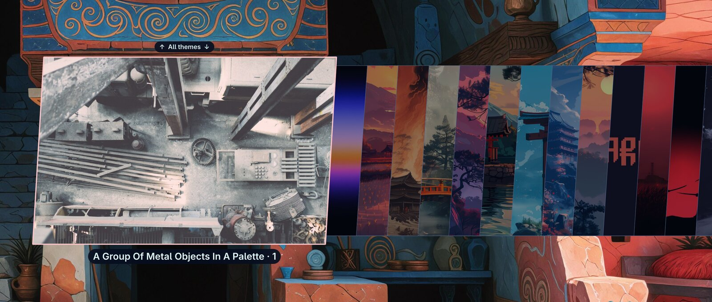
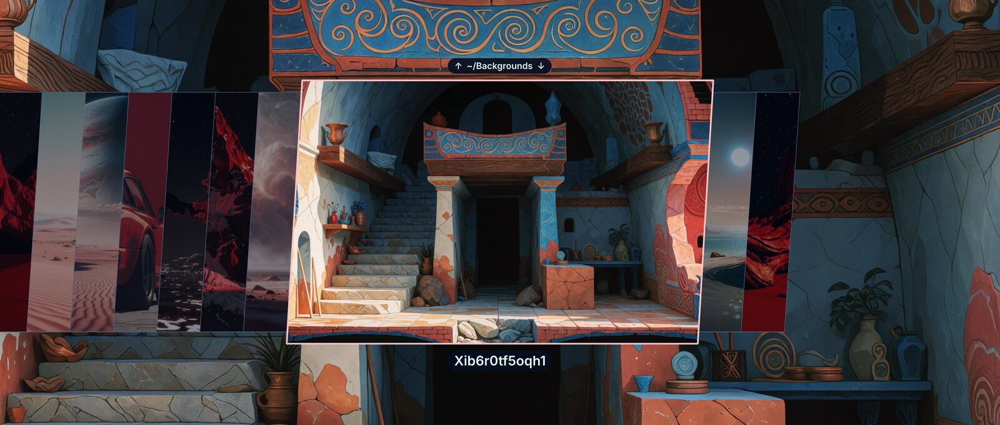

# omarchy-all-backgrounds

Browse and set **any background from any installed Omarchy theme**, all in one picker, plus your own `~/Backgrounds` folder. It uses Omarchy's own image picker, so it looks and works like the stock background switcher (`Super + Ctrl + Space`). The stock switcher stays as it is.



There are two views:

- **All themes** shows backgrounds from every theme: stock themes, themes you installed (`~/.config/omarchy/themes`), and your per-theme extras (`~/.config/omarchy/backgrounds/<theme>`). Duplicates are removed and each image is labelled `<theme> · <n>`.
- **Your folder** shows `~/Backgrounds`, if it exists and contains images or videos.

The picker remembers the **last view you looked at** (saved in `~/.local/state/omarchy-all-backgrounds/last-view`) and opens there next time. The first time, it opens *All themes*. Your current background is selected when it is in that view.



| Key | Action |
|-----|--------|
| `←` `→` / `Tab` | Browse backgrounds |
| `↑` `↓` | Switch between *All themes* and your folder (needs the [picker patch](#picker-patch-arrows--readable-labels); the current view is shown above the images as `↑ All themes ↓`) |
| typing | Filter by theme name (or by file name in your own folder) |
| `Enter` / click | Set the background |
| `Esc` or the shortcut again | Close |

Requires Omarchy 4.x with the Quickshell shell. Tested on 4.5.0rc1.

## Install

```bash
curl -fsSL https://raw.githubusercontent.com/priard/omarchy-all-backgrounds/main/install.sh | bash
```

This installs one command, `~/.local/bin/omarchy-all-backgrounds`. Nothing in `/usr/share/omarchy` is touched.

## Add the keyboard shortcut

```bash
curl -fsSL https://raw.githubusercontent.com/priard/omarchy-all-backgrounds/main/install.sh | bash -s -- bind
```

This binds **`Super + Ctrl + Alt + Space`**, which is free on a stock Omarchy. To use different keys and/or a different personal folder, run:

```bash
curl -fsSL https://raw.githubusercontent.com/priard/omarchy-all-backgrounds/main/install.sh | bash -s -- bind "SUPER + SHIFT + B" ~/Pictures/Wallpapers
```

The binding goes into `~/.config/hypr/bindings.lua` between `-- BEGIN/END omarchy-all-backgrounds` markers. Running the command again replaces the binding instead of adding a second one. Make sure the combo is free first: `omarchy menu keybindings --print`.

## Optional extras

**Menu entry.** This adds *All Backgrounds* under Omarchy menu → Style, which you can also find by searching for "all-backgrounds":

```bash
curl -fsSL https://raw.githubusercontent.com/priard/omarchy-all-backgrounds/main/install.sh | bash -s -- menu
```

### Picker patch: arrows + readable labels

```bash
curl -fsSL https://raw.githubusercontent.com/priard/omarchy-all-backgrounds/main/install.sh | bash -s -- picker
```

- **`↑` / `↓` switch views.** Without this patch, the switcher still opens your last view, but you can't move to the other view from the picker.
- **Resolution.** The selected background shows its own size (e.g. `3840 × 2160`) in its corner, so you can tell at a glance whether it fits your screen. The sizes come from one `vipsheader` run over the view (about 120ms for 250 images) and are reused until the view's images change.
- **Label shape.** Label backgrounds lean at the same angle as the picker's cards and follow Hyprland's `decoration:rounding`: square with rounding off, rounded as much as your windows otherwise.
- **Readable labels.** The stock picker draws its label in the theme's text color directly over the desktop. On some themes, especially light or older ones, that is hard to read. The patch puts the label (and the filter text and view title) on a pill in the theme's background color. It keeps the theme's text color when that has at least 4.5:1 contrast (WCAG AA), and otherwise switches to black or white, whichever reads better.

This uses Omarchy's own mechanism: `omarchy plugin clone omarchy.image-picker` creates `~/.config/omarchy/plugins/<you>.image-picker`, and a small patch is applied to it. The clone also replaces the picker used by the stock background and theme switchers. They get the readable labels too, but the arrows only do anything in this switcher. **Note:** the clone does not receive Omarchy's future fixes to the picker. If something looks off after an update, run `omarchy plugin remove <you>.image-picker` to go back to stock, then re-run `picker`. If you had an older version of this patch, re-running `picker` upgrades it and keeps `ImagePicker.qml.bak`. If the patch doesn't apply to your Omarchy version, the installer removes the fresh clone and leaves the stock picker alone.

## How it works

- **All themes:** collects `backgrounds/` from `/usr/share/omarchy/themes/*`, `~/.config/omarchy/themes/*` and `~/.config/omarchy/backgrounds/*`. Duplicates are found by content: only files of the same size are hashed, so this stays fast. The result is a folder of `<theme> · <n>` symlinks in `~/.cache/omarchy-all-backgrounds`, which is rebuilt only when the set of backgrounds changes. Rows and thumbnails come from Omarchy's `omarchy-menu-images --print-rows`. The picker is then opened over the shell's `image-selector` IPC with a view title, which the patched picker uses for the arrows.
- **Thumbnails** are generated lazily in the background and cached by Omarchy (`~/.cache/omarchy/image-selector`). The first open can take a moment, mostly for video backgrounds. If the picker hasn't appeared after 0.3 s, an OSD shows *Loading backgrounds…* until it does.
- **Setting** a background calls the stock `omarchy-theme-bg-set`, the same as the built-in switcher. Switching themes later resets the background to the new theme's default, as usual in Omarchy.
- **Views:** `↑`/`↓` make the patched picker answer `omarchy-all-backgrounds:prev|next` instead of a file path, and the script reopens the picker on the other view. The last view is kept in `~/.local/state/omarchy-all-backgrounds/last-view`. While the picker is open, the script's PID is kept in `$XDG_RUNTIME_DIR/omarchy-all-backgrounds.run`, so pressing the shortcut again closes the picker.

## Security notes

- `curl … | bash` runs whatever is on `main` at that moment. To check first, download `install.sh`, read it, and run it, or clone the repo and use `./install.sh`. The installer only writes to your home directory and never uses `sudo`.
- Every installed theme's media gets thumbnailed (vips / ffmpegthumbnailer), just like the stock theme picker does for theme previews. Install themes only from sources you trust.
- File and folder names are treated as data. Names containing a tab or newline are skipped, and `bind` accepts only plain key names and folder paths without quotes, `$`, backticks or backslashes.
- The `picker` patch changes the picker's colors and layout and adds the arrow keys. The only thing it ever writes is its fixed answer to the script's selection file, using the same mechanism the picker already uses for a chosen path.

## Uninstall

```bash
curl -fsSL https://raw.githubusercontent.com/priard/omarchy-all-backgrounds/main/install.sh | bash -s -- uninstall
```

This removes the command, the keybinding block, the menu entry and the cache. If the picker patch is installed, it also removes the patched picker clone; `omarchy plugin remove` keeps a backup.

## From a checkout

```bash
git clone https://github.com/priard/omarchy-all-backgrounds && cd omarchy-all-backgrounds
./install.sh && ./install.sh bind && ./install.sh menu && ./install.sh picker
```

## License

MIT. `picker.patch` modifies Omarchy's `ImagePicker.qml` (Omarchy is MIT-licensed).
